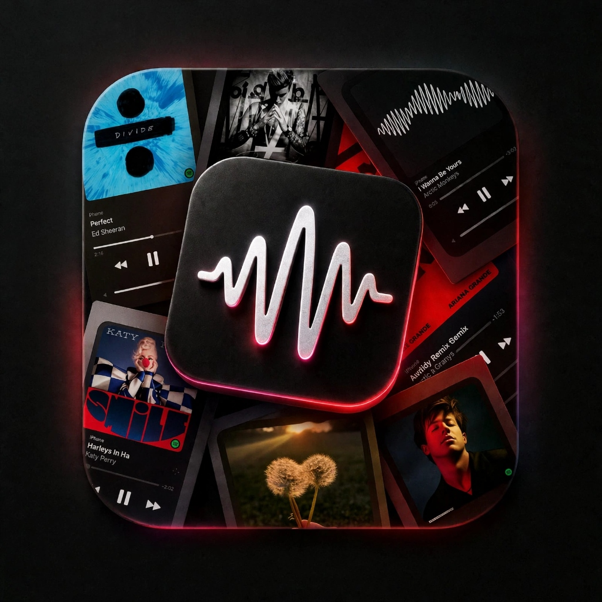
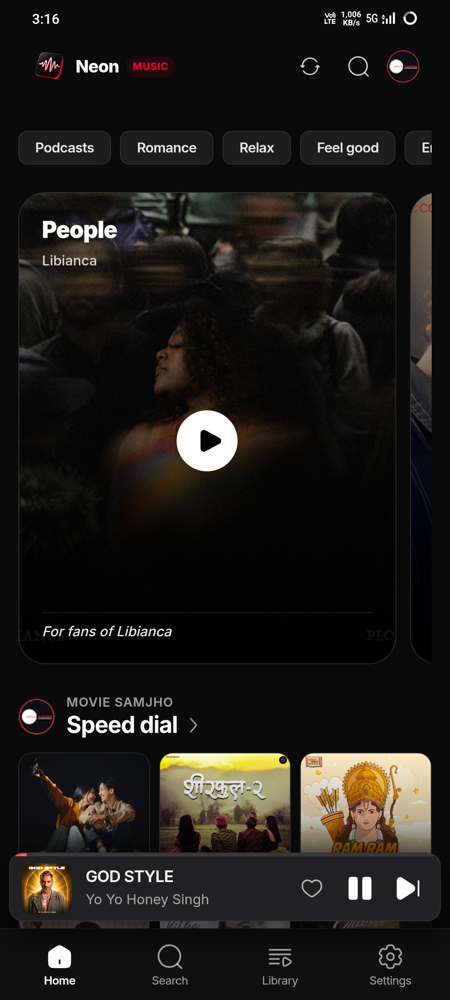
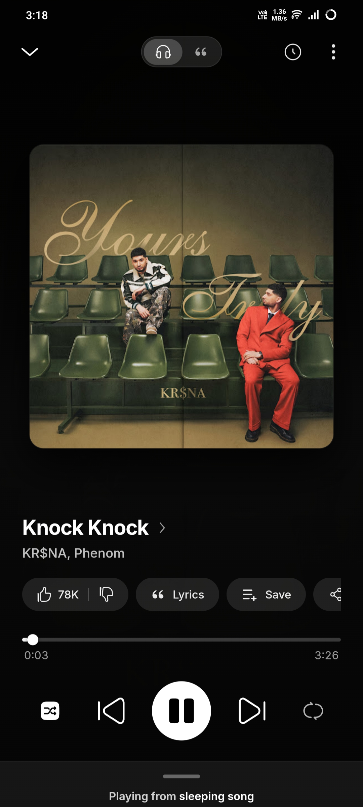
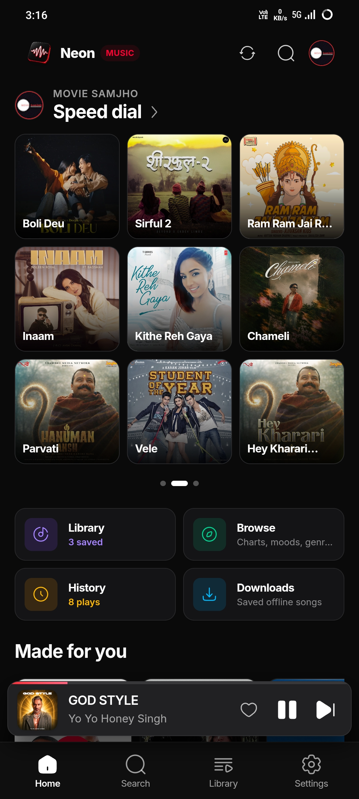
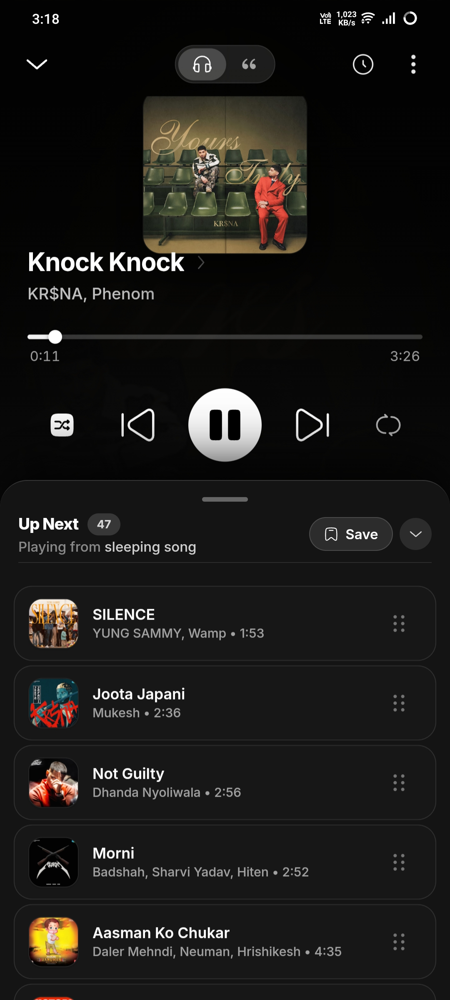
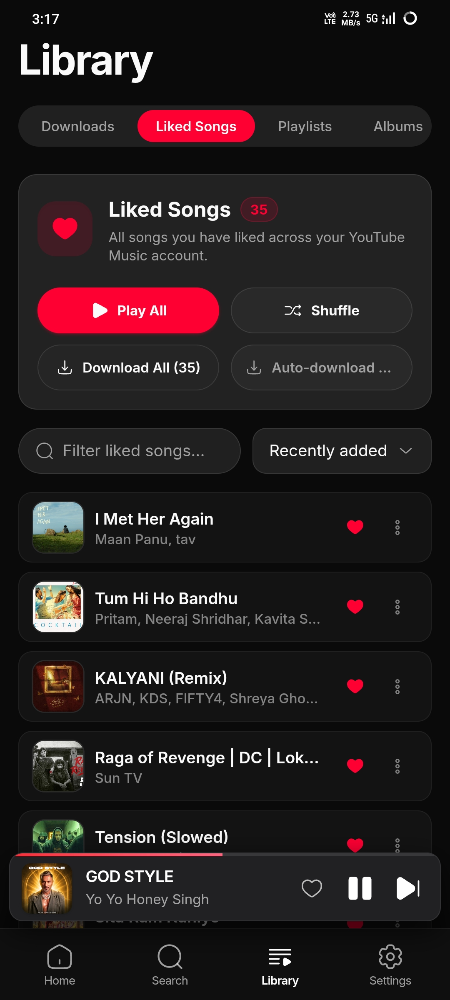
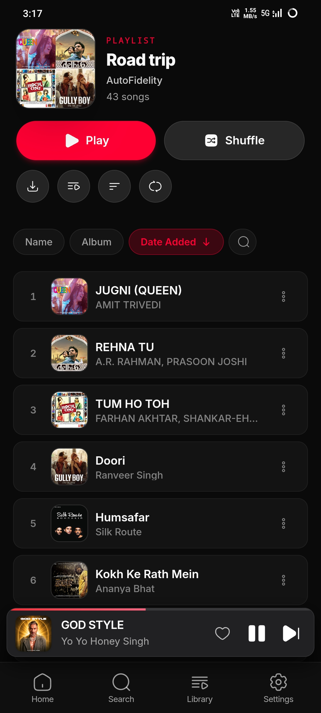
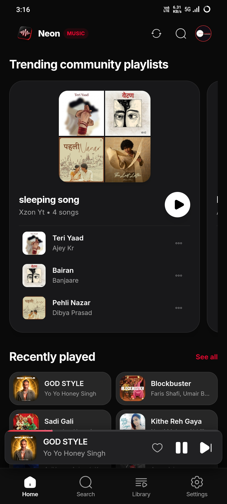
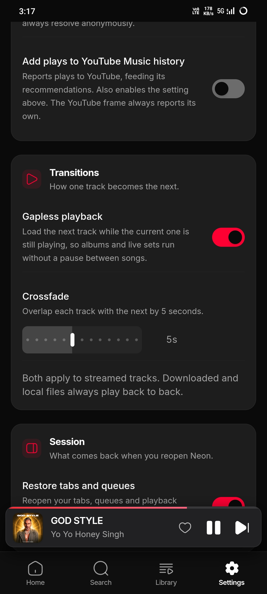

<p align="center">
  
</p>

<h1 align="center">Neon Music</h1>

<p align="center">
  <b>A fast, modern, and beautiful music streaming client powered by YouTube Music.</b><br />
  Built with Tauri v2, Rust, React, and TypeScript for <b>Android, iOS, Windows, macOS, and Linux</b>.
</p>

<p align="center">
  <a href="https://github.com/eveyka/Neno-Music-App/releases/tag/v1.0.5"></a>
  <a href="https://github.com/eveyka/Neno-Music-App/releases/tag/v1.0.5"></a>
  <a href="LICENSE"></a>
  <a href="https://github.com/eveyka/Neno-Music-App/stargazers"></a>
</p>

---

## 🎧 About Neon Music

**Neon Music** is a high-performance, ad-free music streaming client designed to bring the entire YouTube Music catalog into a native, ultra-responsive, and distraction-free environment. 

Unlike web tabs and bulky Electron wrappers, Neon Music is powered by **Tauri 2** with a native **Rust audio core (Rodio & Symphonia)**. This architecture ensures instant cold starts, minimal battery usage, negligible RAM consumption, and true hardware-accelerated playback across mobile and desktop devices.

> [!NOTE]
> Neon Music is an independent, community-driven open-source project and is not affiliated with, authorized, or endorsed by Google or YouTube.

---

## 📸 Screenshots Showcase

<div align="center">
  <table>
    <tr>
      <td align="center" width="50%">
        <a href="assets/Screenshoots/01_Home_Dashboard.jpg">
          
        </a>
        <br />
        <sub><b>🏠 Home Dashboard & Daily Discover</b></sub>
      </td>
      <td align="center" width="50%">
        <a href="assets/Screenshoots/04_NowPlaying_Player.jpg">
          
        </a>
        <br />
        <sub><b>🎵 Modern Full-Screen Now Playing</b></sub>
      </td>
    </tr>
    <tr>
      <td align="center" width="50%">
        <a href="assets/Screenshoots/02_Home_SpeedDial.jpg">
          
        </a>
        <br />
        <sub><b>⚡ Speed Dial & Navigation Hub</b></sub>
      </td>
      <td align="center" width="50%">
        <a href="assets/Screenshoots/05_UpNext_Queue.jpg">
          
        </a>
        <br />
        <sub><b>📑 Interactive Up Next Queue Drawer</b></sub>
      </td>
    </tr>
    <tr>
      <td align="center" width="50%">
        <a href="assets/Screenshoots/06_Library_LikedSongs.jpg">
          
        </a>
        <br />
        <sub><b>❤️ Organized Library & Liked Songs</b></sub>
      </td>
      <td align="center" width="50%">
        <a href="assets/Screenshoots/07_Playlist_View.jpg">
          
        </a>
        <br />
        <sub><b>🎶 High-Contrast Playlist View</b></sub>
      </td>
    </tr>
    <tr>
      <td align="center" width="50%">
        <a href="assets/Screenshoots/03_Home_Trending.jpg">
          
        </a>
        <br />
        <sub><b>🔥 Trending Community Playlists</b></sub>
      </td>
      <td align="center" width="50%">
        <a href="assets/Screenshoots/09_Settings_Audio.jpg">
          
        </a>
        <br />
        <sub><b>⚙️ Audio Gapless & Crossfade Controls</b></sub>
      </td>
    </tr>
  </table>
</div>

---

## ✨ Core Features

### 🚀 Instant Performance & Efficiency
- **Native Rust Audio Engine**: Symphonia & Rodio hardware decoding for lower CPU usage and instant playback responsiveness.
- **Zero Audio Ads**: Continuous, uninterrupted music playback without intrusive audio commercial interruptions.
- **Ultra-Lightweight**: Android APK size is only **~11.3 MB** with rapid cold launch.

### 📱 Android Background Playback & Smart System Integration
- **Persistent Background Playback**: Continuous playback with screen off and while switching between apps.
- **System Media Controls**: Lock screen and notification shade controls with track art, seekbar, and playback buttons.
- **Intelligent Phone Call Auto-Resume**: Automatically pauses during incoming/active phone calls and resumes seamlessly at the exact timestamp once the call ends.
- **Error Auto-Recovery**: Automatic graceful fallback and queue progression if a stream encounters restrictions or network hiccups.

### 🎵 High-Fidelity Audio & Studio Controls
- **Audio Quality Options**: Stream at High Quality (256 kbps Opus/AAC), Normal, or Data-Saver modes.
- **Configurable Crossfade**: Smoothly blend songs together with customizable fade duration (0–12s).
- **Gapless Handover**: Preload incoming tracks on standby audio decks for zero silence between consecutive songs.

### 🎤 Synchronized Karaoke Lyrics
- **Real-Time Word & Line Sync**: Words highlight synchronously as the artist sings.
- **Interactive Lyric Seeking**: Tap any lyric line to instantly jump to that part of the song.
- **Multilingual Translations**: Automatically translate lyrics across 20+ languages.
- **Timing Offset Adjustment**: Fine-tune delay (+/- ms) to align lyrics to any audio stream.

### 💾 Offline Downloads & Storage Manager
- **1-Click Offline Downloads**: Download individual tracks, entire albums, or custom playlists.
- **Native Offline Playback**: Listen on airplanes, subways, or anywhere without an internet connection.
- **Storage Limits**: Set cache limits and manage device storage directly from settings.

---

## 📥 Downloads & Installation

Official binaries and APKs are available on the **[Releases Page (v1.0.5)](https://github.com/eveyka/Neno-Music-App/releases/tag/v1.0.5)**:

| Platform | Download Package | Details |
|---|---|---|
| **Android (ARM64)** | [Neno-Music-v1.0.5-Android-arm64.apk](https://github.com/eveyka/Neno-Music-App/releases/download/v1.0.5/Neno-Music-v1.0.5-Android-arm64.apk) | **Recommended** for modern phones (~11.3 MB) |
| **Android (Universal)** | [Neno-Music-v1.0.5-Android-universal.apk](https://github.com/eveyka/Neno-Music-App/releases/download/v1.0.5/Neno-Music-v1.0.5-Android-universal.apk) | Compatible with all Android architectures (~35 MB) |
| **Android (ARM32)** | [Neon-Music-v1.0.5-armeabi-v7a.apk](https://github.com/eveyka/Neno-Music-App/releases/download/v1.0.5/Neon-Music-v1.0.5-armeabi-v7a.apk) | For legacy 32-bit Android devices (~10 MB) |
| **iOS (iPhone / iPad)** | [Neno-Music-v1.0.5-iOS.ipa](https://github.com/eveyka/Neno-Music-App/releases/download/v1.0.5/Neno-Music-v1.0.5-iOS.ipa) | Sideload via AltStore, Sideloadly, TrollStore |
| **Windows / macOS / Linux** | [Desktop Releases](https://github.com/eveyka/Neno-Music-App/releases/tag/v1.0.5) | Direct MSI, DMG, AppImage, and DEB builds |

> **Android Installation Note**: If installing an APK directly, ensure "Install unknown apps" permission is enabled for your browser or file manager.

---

## 🛠️ Architecture & Tech Stack

```
┌────────────────────────────────────────────────────────┐
│                   Neon Music Architecture              │
├──────────────────────────┬─────────────────────────────┤
│ Frontend (UI / React 19) │ Vite 7 · TypeScript · Tailwind CSS │
│ Core Desktop & Mobile    │ Tauri 2 · Rust 2021         │
│ Audio Pipeline           │ Rodio · Symphonia (Opus/AAC)│
│ Android Integration      │ MediaSessionCompat · AAudio │
│ Network & Data Source    │ YouTube Music InnerTube API │
└──────────────────────────┴─────────────────────────────┘
```

---

## 🧑‍💻 Building from Source

### Prerequisites
- [Node.js](https://nodejs.org/) (v18 or newer)
- [Rust](https://rustup.rs/) (stable channel)
- For Android: Android SDK, NDK (27+), and Java 17+

### 1. Clone the repository
```bash
git clone https://github.com/eveyka/Neno-Music-App.git
cd Neno-Music-App
```

### 2. Install dependencies
```bash
npm install
```

### 3. Run development mode
```bash
# Frontend dev server:
npm run dev

# Or with Tauri desktop window:
npm run tauri dev
```

### 4. Build release packages
```bash
# Build desktop packages:
npm run tauri build

# Build Android APKs:
npx tauri android build --apk
```

---

## 🛡️ License

This project is licensed under the **Apache License, Version 2.0**. See the [LICENSE](LICENSE) file for complete details.

```
Copyright 2026 Neon Music Contributors

Licensed under the Apache License, Version 2.0 (the "License");
you may not use this file except in compliance with the License.
You may obtain a copy of the License at

    http://www.apache.org/licenses/LICENSE-2.0
```

<p align="center">
  <b>Neon Music</b> — Built with ❤️ for music enthusiasts worldwide.
</p>
